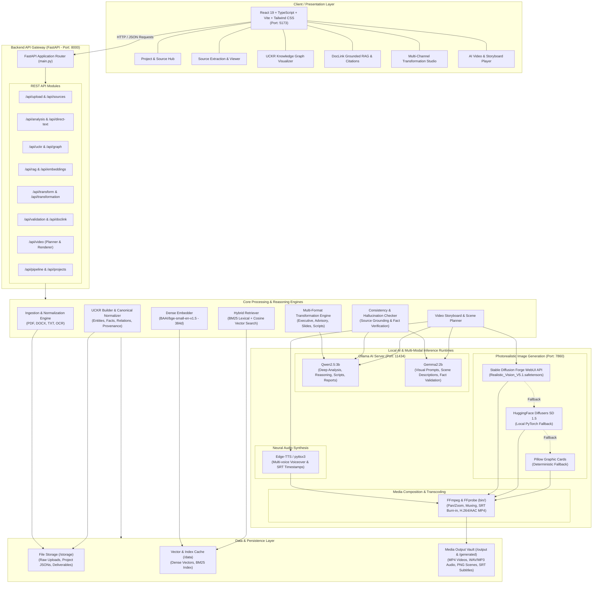
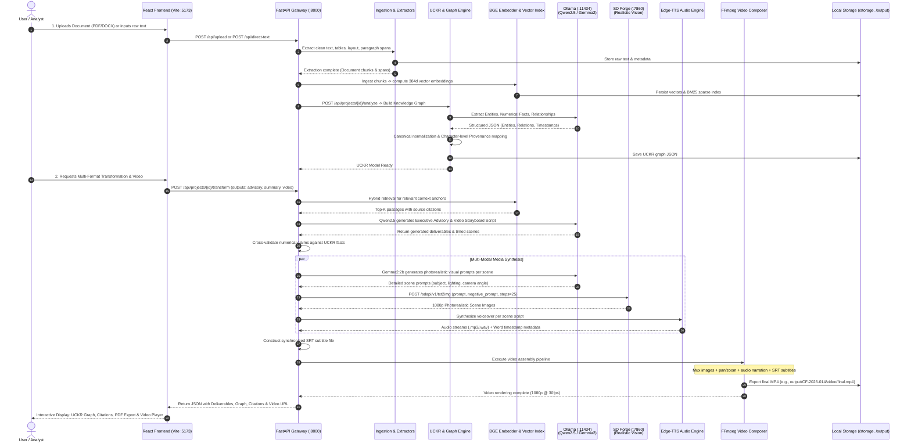

# Gen-Transform-AI / DocLink Grounded RAG Platform
## System Architecture & End-to-End Process Specification

This document provides a comprehensive architectural blueprint and full lifecycle process breakdown for the **Gen-Transform-AI / DocLink Grounded RAG Platform**.

---

## 1. High-Level System Architecture (Container Diagram)



---

## 2. Complete End-to-End Pipeline Process Flow

The lifecycle of an enterprise document transforming into grounded advisories, knowledge graphs, verified scripts, and a photorealistic synchronized video follows **8 discrete phases**:

```mermaid
flowchart TD
    Start([User Initiates Document Upload / Input]) --> P1_1[Ingest Unstructured Input: PDF, DOCX, TXT, Direct Text]
    
    subgraph Phase1 ["Phase 1: Ingestion & Text Extraction"]
        P1_1 --> P1_2[Format Detection & Text Sanitization]
        P1_2 --> P1_3[Layout & Table Structure Extraction]
        P1_3 --> P1_4[Sentence & Paragraph Boundary Segmentation]
        P1_4 --> P1_5[Assign Source Spans & Character Offsets]
    end

    subgraph Phase2 ["Phase 2: Hybrid Indexing & Embedding"]
        P1_5 --> P2_1[Semantic Chunking with Sliding Window]
        P2_1 --> P2_2[Generate 384d Dense Vectors via BAAI/bge-small-en-v1.5]
        P2_1 --> P2_3[Build BM25 Sparse Inverted Index]
        P2_2 & P2_3 --> P2_4[Store In-Memory & Local Vector Cache]
    end

    subgraph Phase3 ["Phase 3: UCKR Knowledge Graph Construction"]
        P2_4 --> P3_1[Extract Entities: Persons, Orgs, Assets, Metrics, Timestamps]
        P3_1 --> P3_2[Extract Core Facts & Numerical Assertions]
        P3_2 --> P3_3[Extract Relational Triples: Subject - Predicate - Object]
        P3_3 --> P3_4[Canonical Normalization: Resolve Aliases & Timestamps]
        P3_4 --> P3_5[Build UCKR Graph JSON & Strict Provenance Mapping]
    end

    subgraph Phase4 ["Phase 4: Grounded RAG & DocLink Retrieval"]
        P3_5 --> P4_1[Query / Transformation Context Request]
        P4_1 --> P4_2[Hybrid Retrieval: Dense Cosine Similarity + BM25 Score]
        P4_2 --> P4_3[Reciprocal Rank Fusion RRF]
        P4_3 --> P4_4[Attach Source Span Citations to Retrieved Passages]
    end

    subgraph Phase5 ["Phase 5: Multi-Channel Transformation"]
        P4_4 --> P5_1[Dispatch Context to Ollama Qwen2.5:3b]
        P5_1 --> P5_2[Executive Brief & Incident Analysis]
        P5_1 --> P5_3[Technical Advisory & Action Plan]
        P5_1 --> P5_4[Social Channels: LinkedIn Post & Twitter/X Thread]
        P5_1 --> P5_5[Visual Deck Outline & Infographic Structure]
        P5_1 --> P5_6[Storyboard & Multi-Scene Video Script with Timings]
    end

    subgraph Phase6 ["Phase 6: Consistency & Hallucination Verification"]
        P5_2 & P5_3 & P5_6 --> P6_1[Cross-Validate Generated Outputs against UCKR Facts]
        P6_1 --> P6_2[Validate Metric Accuracy, Entity Claims & Dates]
        P6_2 --> P6_3{Contradictions Detected?}
        P6_3 -- Yes --> P6_4[Auto-Correction Loop / Flag Hallucinations in Report]
        P6_3 -- No --> P6_5[Generate Grounding Confidence Score & Verification Pass]
    end

    subgraph Phase7 ["Phase 7: Multi-Modal Media Synthesis"]
        P6_5 --> P7_ScenePlan[Parse Video Script into Ordered Scene Units]
        
        %% Visual Pipeline
        P7_ScenePlan --> P7_PromptGen[Gemma2:2b Generates Photorealistic Visual Prompts]
        P7_PromptGen --> P7_ImgGen{SD Forge Port 7860 Available?}
        P7_ImgGen -- Yes --> P7_Forge[Synthesize 1080p Images via Realistic_Vision_V5.1]
        P7_ImgGen -- No / Fallback --> P7_Diffusers[HF Diffusers SD 1.5 / Pillow Card Generator]
        
        %% Audio Pipeline
        P7_ScenePlan --> P7_TTS[Edge-TTS Synthesizes Natural Voiceover Audio]
        P7_TTS --> P7_AudioFiles[Generate Scene Audio WAV/MP3]
        P7_TTS --> P7_SRT[Calculate Word Timestamps & Generate SRT Subtitles]
    end

    subgraph Phase8 ["Phase 8: Video Assembly & Final Delivery"]
        P7_Forge & P7_Diffusers --> P8_VisualPlates[Visual Scene Frames]
        P7_AudioFiles & P7_SRT --> P8_AudioSub[Audio Streams & Subtitles]
        
        P8_VisualPlates & P8_AudioSub --> P8_FFmpeg[FFmpeg Video Assembly Engine]
        P8_FFmpeg --> P8_Filter[Apply Ken Burns Pan/Zoom & Crossfade Transitions]
        P8_Filter --> P8_Mux[Mux Audio, Burn/Embed SRT Subtitles, Encode H.264 MP4]
        P8_Mux --> P8_Final[Production Deliverables in /output/ and /generated/]
    end

    P8_Final --> End([Frontend Delivers Verified Advisory, Graph & Interactive Video])
```



---

## 3. Sequence Diagram: Full Execution Request Lifecycle

The sequence below illustrates how an end-to-end request flows across the user interface, backend routers, reasoning orchestrators, local AI runtimes, and local storage.



---

## 4. Component Architecture & Responsibility Matrix

| Layer | Component | Implementation | Primary Responsibility |
| :--- | :--- | :--- | :--- |
| **Frontend** | `Frontend/src/App.tsx` | React 19, TypeScript, Tailwind | Single-page application router, global project state, dark/light theme |
| **Frontend** | `Frontend/src/components/dashboard` | React Components | Workspace projects list, file uploads, system health indicators |
| **Frontend** | `Frontend/src/components/uckr` | React / Canvas / Graph | Interactive visualization of Canonical Entities, Facts, and Relational Triples |
| **Frontend** | `Frontend/src/components/results` | React Components, Modal | DocLink citation inspector, sentence-level source viewer, RAG search |
| **Frontend** | `Frontend/src/components/transformation` | React Components | Tabbed interface for Executive Brief, Advisory, LinkedIn, Video Player |
| **API** | `Backend/app/main.py` | FastAPI, Uvicorn | App lifecycle, CORS middleware, centralized logging, exception handlers |
| **API** | `Backend/app/api/routes/` | FastAPI Routers | Modular route endpoints (`projects`, `sources`, `uckr`, `rag`, `video`, etc.) |
| **Ingestion** | `Backend/app/ingestion/` | PyPDF, python-docx, OCR | Document parsing, text cleaning, layout analysis, character-span attribution |
| **Graph / UCKR** | `Backend/app/doclink/` & `uckr/` | Python, NetworkX / JSON | Entity extraction, canonical normalizer, fact deduplication, source provenance |
| **Vector Engine** | `Backend/app/embeddings/` | PyTorch, HuggingFace | `BAAI/bge-small-en-v1.5` 384d dense embeddings, cosine similarity search |
| **Hybrid RAG** | `Backend/app/rag/` | BM25 + Vector | Hybrid lexical-semantic retrieval, Reciprocal Rank Fusion, citation injection |
| **Transformation** | `Backend/app/transformation/` | Python Templates, Ollama | Prompt engineering, tone adaptation, multi-deliverable structuring |
| **Validation** | `Backend/app/validation/` | Python, Ollama Qwen | Grounding verification, fact check, numerical consistency, anti-hallucination |
| **Visual Media** | `Backend/video/scene_generator.py` | SD Forge API / Diffusers | Scene prompt generation (Gemma2), txt2img generation (Realistic Vision V5.1) |
| **Audio Media** | `Backend/video/tts_generator.py` | Edge-TTS, pyttsx3 | Natural voice narration synthesis, audio duration timing, SRT subtitles |
| **Video Media** | `Backend/video/renderer.py` | FFmpeg / FFprobe | Image pan/zoom motion, audio-video muxing, subtitle burn-in, MP4 rendering |

---

## 5. Storage & File Hierarchy

```
Gen-Transform-AI/
├── bin/                              # Local binary toolchain
│   ├── ffmpeg.exe                    # FFmpeg video encoding engine
│   └── ffprobe.exe                   # Media analysis & duration probe
├── Backend/                          # FastAPI Backend Application
│   ├── app/
│   │   ├── api/routes/               # HTTP endpoints (REST API)
│   │   ├── core/                     # Config, token budgets, logging
│   │   ├── doclink/                  # Entity & fact extraction, normalizers
│   │   ├── embeddings/               # BGE-small embedding model cache & loader
│   │   ├── ingestion/                # Document format parsers & chunkers
│   │   ├── rag/                      # Hybrid retrieval (BM25 + Cosine)
│   │   ├── transformation/           # Multi-format delivery templates
│   │   ├── uckr/                     # Canonical knowledge graph structures
│   │   └── validation/               # Fact consistency & grounding validators
│   ├── video/                        # Video production pipeline
│   │   ├── planner.py                # Storyboard breakdown & timing
│   │   ├── scene_generator.py        # Visual prompts & image synthesis
│   │   ├── tts_generator.py          # Voiceover & subtitle generation
│   │   └── renderer.py               # FFmpeg execution & composition
│   ├── generated/                    # Temporary video & audio working directory
│   ├── requirements.txt              # Python runtime dependencies
│   └── download_model.py             # HuggingFace model cache utility
├── Frontend/                         # React 19 Frontend Application
│   ├── src/
│   │   ├── components/               # Dashboard, UCKR graph, RAG modals, Video
│   │   ├── services/                 # API client services (Axios / Fetch)
│   │   └── types/                    # TypeScript interfaces for API schemas
│   └── package.json                  # Frontend dependencies & scripts
├── storage/                          # Persistent storage layer
│   ├── users/                        # Multi-tenant user workspaces
│   │   └── {user_id}/projects/{id}/  # Extracted sources, UCKR JSONs, deliverables
│   └── active_params.json            # Dynamic AI runtime hyperparameter config
├── data/                             # In-memory / cached vector indices
├── output/                           # Production Deliverable Artifacts
│   └── {case_id}/
│       ├── report/                   # Generated executive & incident advisories (.md, .pdf)
│       ├── scenes/                   # 1080p photorealistic scene images (.png)
│       ├── audio/                    # Narrated voiceover tracks (.wav, .mp3)
│       ├── subtitles/                # Synchronized subtitle files (.srt)
│       └── video/                    # Final assembled video (.mp4)
├── download.bat                      # 1-Click Asset & Model Downloader
└── start.bat                         # 1-Click 4-Terminal Master Launcher
```

---

## 6. Runtime Services & Port Topology

```
+--------------------------------------------------------------------------------+
|                             LOCAL RUNTIME TOPOLOGY                             |
+--------------------------------------------------------------------------------+
|                                                                                |
|   [Port 5173] React 19 + Vite Frontend                                         |
|        ^                                                                       |
|        | (HTTP REST / JSON)                                                    |
|        v                                                                       |
|   [Port 8000] FastAPI Backend Server (Uvicorn)                                 |
|        |                                                                       |
|        +---> [Port 11434] Ollama Local AI Server                               |
|        |          ├── Model: qwen2.5:3b (Analysis, Reasoning, Scripts)        |
|        |          └── Model: gemma2:2b (Visual Descriptions & Validation)      |
|        |                                                                       |
|        +---> [Port 7860] Stable Diffusion Forge WebUI API                      |
|        |          └── Checkpoint: Realistic_Vision_V5.1.safetensors            |
|        |                                                                       |
|        +---> [Local Subprocess] FFmpeg & FFprobe (bin/)                        |
|        |          └── Video Encoding, Audio Muxing, Subtitles, MP4 Rendering   |
|        |                                                                       |
|        +---> [Local Embeddings] BAAI/bge-small-en-v1.5 (In-process PyTorch)    |
|                                                                                |
+--------------------------------------------------------------------------------+
```

---

## 7. Key Features & Architectural Guarantees

1. **Zero Hallucination Grounding**: Every transformed claim and deliverable is cross-referenced with exact sentence-level character spans from original source files via the DocLink & UCKR engines.
2. **Deterministic Fallbacks**: If external GPU image generation (SD Forge) is offline, the pipeline seamlessly cascades to local HuggingFace Diffusers, and then to typography-rich Pillow card graphics, guaranteeing video generation never fails.
3. **Completely Local & Air-Gapped Capable**: All core AI engines (Ollama Qwen2.5, Gemma2, BGE-small embeddings, SD Forge) operate locally without sending confidential documents to external cloud APIs.
4. **Synchronized Multi-Modal Synthesis**: Precise word-level audio timestamps align voiceover speech with scene frame durations and subtitles for seamless audiovisual storytelling.
